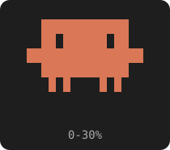
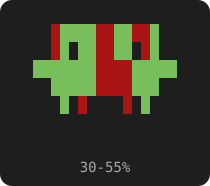
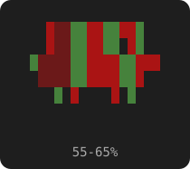
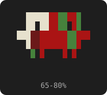
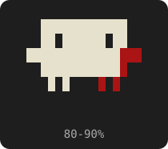
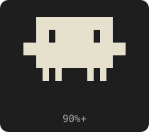

# context-zombie

A Claude Code mod: the Claude logo sits above the prompt (top right) and decays as context fills.

| Context | Look |
|---|---|
| 0-30% | Normal orange |
| 30-65% | Green zombie, growing blood |
| 65-90% | Bone spreads from the top-left of the head |
| 90%+ | Full skeleton |

      

It heals when you `/compact` or `/clear`. Test with `/zombie 0-100`, reset with `/zombie off`.

## Install

```
/plugin install context-zombie --marketplace pragmaticbear/context-zombie
```

Answer `y` to add the marketplace, then pick the user scope.
